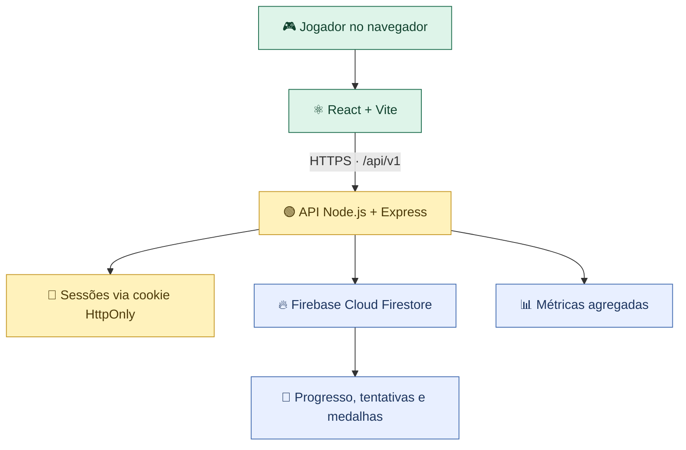

<div align="center">

# 🇧🇷 BRASIL ADVENTURE
### Aventura das Regiões do Brasil

**Descubra · Explore · Aprenda**

Uma jornada educativa e interativa pelas cinco regiões brasileiras, desenvolvida pelo **ByteClub**.

[](https://brasil-adventure.vercel.app/)
[](https://github.com/ByteClub378/Prototipo)
[](LICENSE)

<br/>


</div>

---

> [!IMPORTANT]
> **Endereço oficial:** **https://brasil-adventure.vercel.app/**  
> O antigo domínio `prototipo-gray-two.vercel.app` redireciona para a página inicial. Sessões de jogador são vinculadas aos cookies do respectivo domínio e não são transferidas automaticamente.

## 🧭 Navegação

[🎮 O jogo](#-o-jogo) · [🗺️ Regiões](#️-as-cinco-regiões) · [🏅 Recursos](#-recursos-da-aventura) · [🏗️ Arquitetura](#️-arquitetura) · [💻 Rodar localmente](#-executando-localmente) · [🔐 Segurança](#-segurança-e-privacidade) · [👥 Equipe](#-equipe)

## 🎮 O jogo

**Brasil Adventure** é um jogo educacional voltado a estudantes, especialmente do **2º ao 5º ano do Ensino Fundamental**. Em vez de apenas ler sobre geografia, o jogador avança por desafios envolvendo **biomas, fauna, flora, cultura, culinária e estados brasileiros**.

A experiência combina atividades de descoberta, perguntas, interação visual e recompensas. O objetivo é explorar as cinco regiões, concluir suas missões e conquistar as **Medalhas do Conhecimento**.

<div align="center">

| 🗺️ 5 regiões | 🎯 Missões interativas | 🏅 Medalhas | 📱 Interface responsiva |
|:--:|:--:|:--:|:--:|
| Norte ao Sul | Diferentes mecânicas | Progresso por jornada | Desktop e dispositivos móveis |

</div>

## 🗺️ As cinco regiões

| Região | Missão | O que o jogador explora |
|:---|:---|:---|
| 🌳 **Norte** | Arrastar e associar | Fauna, flora e biomas |
| ☀️ **Nordeste** | Quiz visual | Geografia, cultura, culinária e lendas |
| 🐆 **Centro-Oeste** | Exploração *point & click* | Cerrado, Pantanal e preservação |
| 🧩 **Sudeste** | Quebra-cabeça cartográfico | Estados, mapa e conhecimentos regionais |
| 🔎 **Sul** | Jogo dos sete erros | Observação e elementos regionais |
| ⭐ **Bônus** | Jogo da memória | Revisão de conteúdos das cinco regiões |

<details>
<summary><strong>✨ Como funciona a jornada?</strong></summary>

1. O jogador inicia uma aventura e acessa o mapa.
2. Realiza as missões das regiões disponíveis.
3. Recebe feedback educativo ao longo dos desafios.
4. Registra resultados e desbloqueia novas etapas conforme as regras do jogo.
5. Conquista medalhas e chega ao desafio bônus.

> As regras de pontuação, aprovação e desbloqueio são validadas pelo backend.

</details>

## 🏅 Recursos da aventura

- **Mapa interativo** com estados de progresso e navegação entre regiões.
- **Pontuação e medalhas** vinculadas ao progresso da jornada.
- **Sessões anônimas** para iniciar ou continuar uma partida.
- **Feedback educativo**, efeitos visuais e narração em atividades do jogo.
- **Dicionário de termos** e recursos de acessibilidade disponíveis na interface.
- **Painel de métricas** para acompanhamento agregado de participação e aprendizagem.
- **Layout responsivo** para uso em computadores e dispositivos móveis.

<details>
<summary><strong>📚 Documentação complementar</strong></summary>

- [API e contrato do backend](backend/README.md)
- [Painel administrativo](PAINEL-ADMIN.md)
- [Fase Nordeste](FASE-NORDESTE.md)
- [Relatório da fase Centro-Oeste](RELATORIO-FASE-CENTRO-OESTE.md)

</details>

## 🏗️ Arquitetura



O frontend é publicado na **Vercel** e chama a API por caminhos relativos `/api/v1`, evitando exigir uma URL de backend no navegador. O servidor Express utiliza o **Firebase Admin SDK** para persistência e validação de dados.

<details>
<summary><strong>🗂️ Estrutura do repositório</strong></summary>

```text
Prototipo/
├── api/                 # Entrada serverless da API na Vercel
├── backend/
│   ├── src/             # API, serviços, rotas, validação e repositórios
│   ├── firebase/         # Regras e índices do Firestore
│   └── README.md        # Documentação técnica da API
├── public/              # Recursos estáticos
├── src/
│   ├── components/      # Componentes reutilizáveis
│   ├── context/         # Estado de sessão, pontuação e progresso
│   ├── data/            # Conteúdos e missões
│   ├── pages/           # Telas e fases
│   └── utils/           # Cliente HTTP e utilitários
├── .env.example         # Exemplo SEM credenciais reais
├── package.json
└── vercel.json
```

</details>

## 💻 Executando localmente

**Pré-requisitos:** Node.js compatível com `package.json`, npm e um projeto Firebase/Firestore configurado para desenvolvimento.

```bash
# 1. Clonar o repositório
git clone https://github.com/ByteClub378/Prototipo.git
cd Prototipo

# 2. Instalar dependências
npm install

# 3. Preparar variáveis locais a partir do exemplo
cp .env.example .env

# 4. Configurar o .env localmente (nunca enviá-lo ao GitHub)
# 5. Iniciar frontend e backend
npm run dev:all
```

> No Windows PowerShell, use `Copy-Item .env.example .env` em vez de `cp`, se preferir o comando explícito. O frontend Vite normalmente inicia em `http://localhost:5173` e a API em `http://localhost:3000`.

**Comandos úteis**

| Comando | Finalidade |
|---|---|
| `npm run dev` | Frontend em modo de desenvolvimento |
| `npm run dev:all` | Frontend e backend juntos |
| `npm run build` | Compilação de produção |
| `npm run test:backend` | Testes do backend |
| `npm run lint:backend` | Verificação sintática do backend |
| `npm run lint` | Análise estática do projeto |

<details>
<summary><strong>⚙️ Configuração e deploy</strong></summary>

As variáveis necessárias estão descritas em [`.env.example`](.env.example) e em [`backend/README.md`](backend/README.md).

Na produção, configure os valores sensíveis pelo **painel de variáveis de ambiente da Vercel**, nunca em arquivos versionados. A função `api/index.js` integra o Express à Vercel; o `vercel.json` direciona requisições `/api/*` para essa função e mantém o fallback da SPA.

O domínio público canônico é **https://brasil-adventure.vercel.app/**. Alterações publicadas na branch principal podem disparar novos deployments pela integração GitHub–Vercel.

</details>

## 🔐 Segurança e privacidade

> [!CAUTION]
> **Não publique** arquivos `.env`, chaves privadas do Firebase, `SESSION_SECRET`, cookies de sessão ou credenciais pessoais. O arquivo `.env.example` contém apenas exemplos e marcadores para preenchimento local.

- O backend usa **cookies assinados HttpOnly** e valida a origem das requisições.
- O acesso direto dos clientes ao Firestore é negado pelas regras versionadas em `backend/firebase/firestore.rules`; confirme que elas estejam publicadas no projeto Firebase.
- O painel `/admin` e os endpoints de estatísticas estão **públicos atualmente** e expõem dados agregados, sem exigir login. Avalie autenticação antes de uso com informações sensíveis.
- **Novo jogo** reinicia a jornada atual; **Continuar** busca o progresso da sessão existente. Sessões não são transferidas automaticamente entre domínios.

Encontrou um problema de segurança? **Evite publicar chaves ou dados pessoais em uma issue pública.** Avise a equipe responsável por um canal privado e revogue imediatamente qualquer credencial que tenha sido exposta.

## 👥 Equipe

<div align="center">

### ByteClub
**Planejamento · Qualidade · Desenvolvimento · Aprendizagem**

</div>

Projeto acadêmico desenvolvido em equipe, com funções de **Product Owner, Scrum Master, Quality Assurance e desenvolvimento frontend/backend**, sob orientação docente.

## 📄 Licença

Distribuído nos termos da [Licença Apache 2.0](LICENSE).

---

<div align="center">

### 🌎 O Brasil é o nosso mapa. O conhecimento é a nossa aventura.

[](https://brasil-adventure.vercel.app/)

<sub>Desenvolvido pelo ByteClub · Feito para aprender explorando</sub>

</div>
